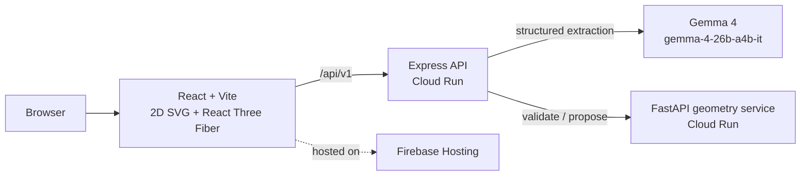

# ADAPT — AI-assisted home accessibility redesign

Upload a floor plan, describe your accessibility needs and budget, and ADAPT proposes an
adapted layout in 2D and 3D, with measured clearances, flagged unknowns, and illustrative
cost ranges.

Built for **AI for Good — Housing × Hacktoberfest** (GDG Virginia Tech).

> **Concept proposals only.** ADAPT does not produce architectural drawings, structural or
> code-compliance determinations, cost quotes, or medical advice. Anything involving
> construction must be reviewed by qualified professionals. A geometric “pass” means only that
> the simplified 2D model meets the target the user confirmed. Unknown is never treated as pass.

## How it works



1. **Gemma 4** turns a plain-language request into *draft* goals (door width, clear path, reachable route).
2. The user **confirms or edits** those goals. Drafts are rejected by the validator.
3. A **deterministic geometry engine** (Python + Shapely) measures door widths, route clearance and collisions,
   returning `pass | fail | unknown` with the element IDs involved.
4. A **bounded planner** applies only permitted demo edits (move movable furniture, widen an editable demo door),
   revalidates every candidate, and never trades away a passing check.
5. Express attaches **illustrative cost ranges** from a fixed catalog ([`data/sample-cost-catalog.json`](data/sample-cost-catalog.json)). No model writes prices.
6. 2D, 3D, findings and costs all render from the **same `Proposal.resultLayout`**.

In the sample apartment, an 800 mm bedroom door and a cabinet narrowing the hallway fail a 900 mm target.
The proposal widens the demo door to 920 mm and moves the cabinet, and every modeled check passes.
A 5,000 mm request intentionally stays failing.

**Gemma 4 model:** `gemma-4-26b-a4b-it` via the Gemini API ([docs](https://ai.google.dev/gemma/docs/core/gemma_on_gemini_api)). Gemma is used for language understanding only; it is never the geometry or cost authority.

## Repository

| Path | What | Owner |
|---|---|---|
| `apps/web` | React + Vite + TS frontend, 2D/3D views | Dev A |
| `apps/api` | Express + TS API, Gemma calls, cost lookup | Dev B |
| `services/geometry` | FastAPI geometry checks and planner ([README](services/geometry/README.md)) | Dev C |
| `packages/report-ui` | Accessible findings, before/after, cost and printable report panels | Dev D |
| `data/` | Canonical sample layout, goals, request fixtures, cost catalog | shared |
| `scripts/` | End-to-end smoke test, bundle secret check, deploy script | Dev D |
| `docs/` | **[Team integration checklist](docs/team-integration.md)**, [architecture](docs/architecture.md), [geometry contract](docs/geometry-integration.md), [deployment](docs/deployment.md), [demo script](docs/demo-script.md), [safety & limitations](docs/safety-limitations.md), [evaluation](docs/evaluation.md) | shared |

## Run it locally

Requires Node 20+ and Python 3.11+. Run every `npm` command from the **repository root**
(it's an npm workspace, so don't run `npm install` inside an app folder).

```bash
git clone https://github.com/Sabalpp/GDG_hackathon.git
cd GDG_hackathon
npm install
cp .env.example apps/api/.env          # then put your Gemini key in apps/api/.env
```

Start the three services in separate terminals:

```bash
# 1. Geometry service (Python)
cd services/geometry
python -m venv .venv
source .venv/bin/activate              # Windows: .venv\Scripts\Activate.ps1
python -m pip install -r requirements-dev.txt
uvicorn app.main:app --reload --port 8000
```

```bash
# 2. API (Express)
npm run dev --workspace apps/api
```

```bash
# 3. Web, wired to the real services through the Vite proxy
npm run dev:full --workspace apps/web  # http://localhost:5173
```

`npm run dev --workspace apps/web` (without `:full`) runs an offline demo with no services. The dev proxy
sends `/api/v1/requirements` and `/api/v1/catalog` to Express (`DEV_API_URL`, default `http://localhost:8080`)
and everything else to geometry (`DEV_GEOMETRY_URL`, default `http://127.0.0.1:8000`). Set
`DEV_ROUTE_ALL_TO_API=1` once Express forwards validate/generate itself.

No Python? Run the geometry service in Docker instead:

```bash
docker build -f services/geometry/Dockerfile -t adapt-geometry .
docker run --rm -p 8000:8080 -e PORT=8080 adapt-geometry
```

## Test

```bash
npm run smoke:geometry                 # demo path against the geometry service on :8000
npm run smoke -- --express             # full path through Express on :8080 (includes a real Gemma call)
npm test --workspace @adapt/report-ui  # report panel tests (run against real geometry fixtures)
cd services/geometry && pytest -q      # geometry unit tests
```

The smoke test checks the parts judges care about: the original layout fails measured checks, the proposal
flips them to pass on revalidation, an impossible request is never labelled feasible, a missing measurement
becomes `unknown` rather than `pass`, and unconfirmed AI goals are rejected.

Preview the report panels on their own: `npm run dev --workspace @adapt/report-ui`.

## Deploy (Google Cloud)

Frontend on **Firebase Hosting**, API and geometry on **Cloud Run**, Gemini key in **Secret Manager**.
See [docs/deployment.md](docs/deployment.md). In short:

```powershell
.\scripts\deploy.ps1 -ProjectId <your-project-id>
```

## License

[MIT](LICENSE). Gemma models are subject to the [Gemma Terms of Use](https://ai.google.dev/gemma/terms).
