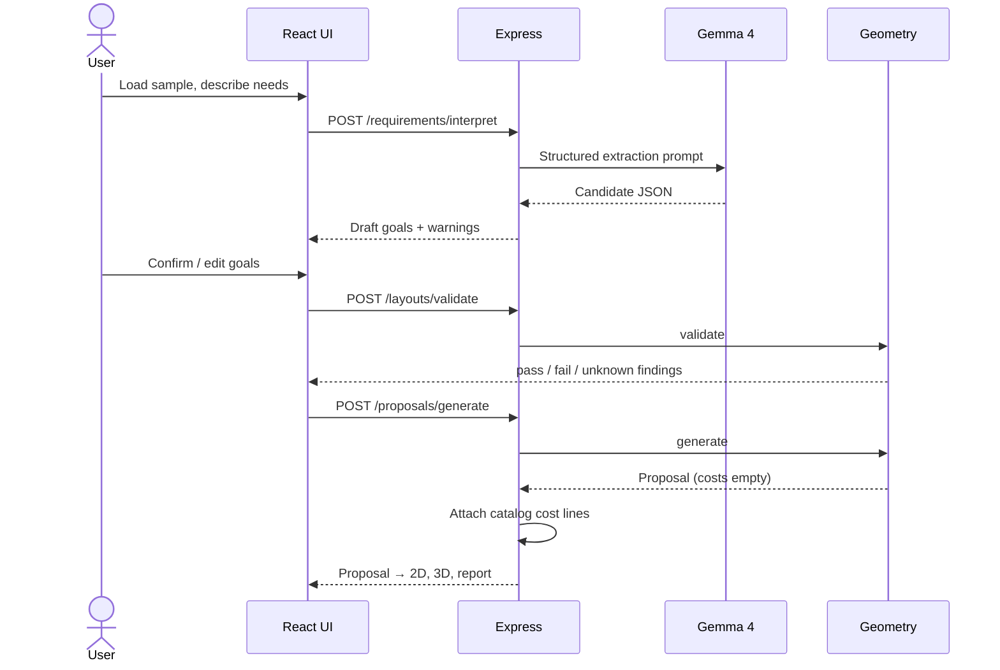

# Architecture

```mermaid
flowchart LR
  U[User browser] --> W[React + Vite + TS]
  W --> E[Express API]
  E --> G[Gemma 4 via Gemini API]
  E --> P[FastAPI geometry + planner]
  W --> V[2D SVG + React Three Fiber 3D]
  W --> R[@adapt/report-ui panels]
```

## Responsibilities

| Layer | Does | Never does |
|---|---|---|
| Frontend (`apps/web`) | Forms, goal confirmation, 2D/3D rendering, before/after | Invents geometry, calls Gemma or Python directly |
| Report UI (`packages/report-ui`) | Findings with text and icon verdicts, before/after table, cost worksheet, print-to-PDF | Computes verdicts; it only displays them |
| API (`apps/api`) | Validation, Gemma prompts, cost catalog lookup, orchestration | Trusts model output without schema validation; authors prices |
| Geometry (`services/geometry`) | Door/route/collision checks, bounded proposals | Calls AI; claims compliance |
| Gemma 4 | Natural language → draft goals; explanations | Measurement, collision, cost, or legal authority |

## Data flow



## Invariants

- One canonical `Layout` JSON in millimeters; `x` right, `y` down, origin top-left. Converted to meters only in 3D render helpers.
- 2D, 3D, findings and costs all read `Proposal.resultLayout` and its IDs.
- `unknown` is not `pass`. If the geometry service is unreachable, the UI shows "validation unavailable", never passes.
- AI goals stay `draft` until a user confirms them; the validator returns 422 for drafts.
- Cost totals are table lookups, labelled illustrative.

Endpoint details: [geometry-integration.md](geometry-integration.md) and [geometry-openapi.json](geometry-openapi.json).
